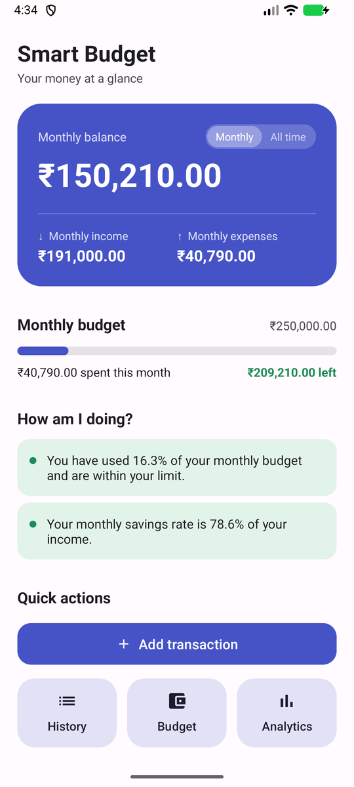
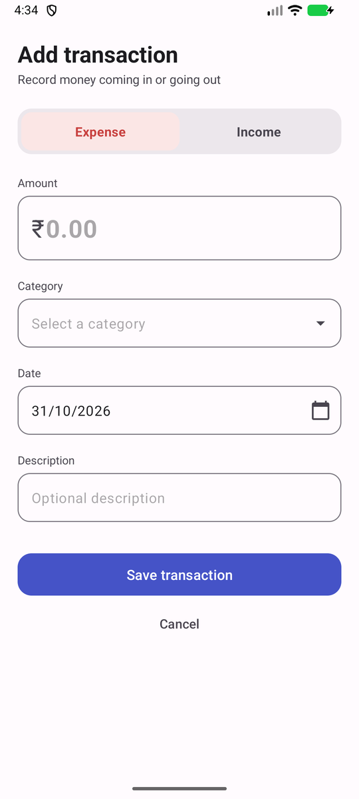
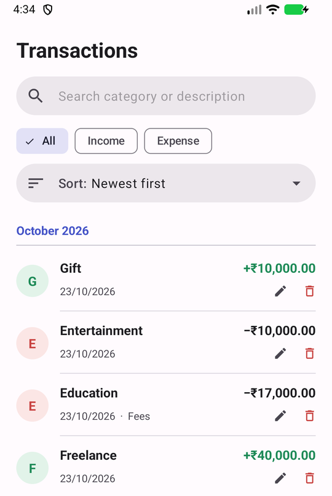
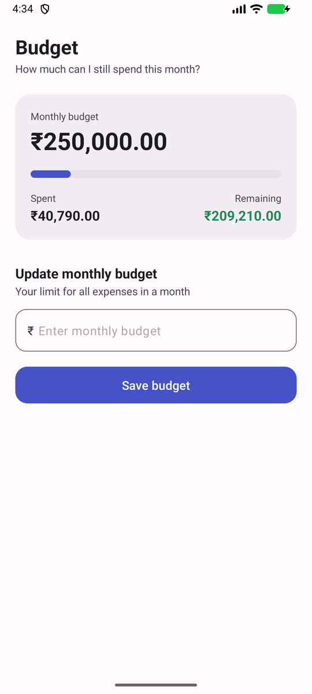
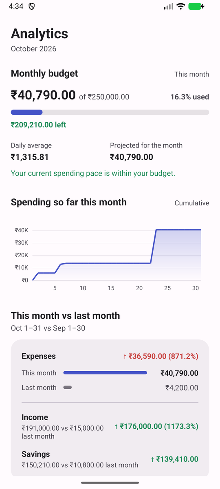

# Smart Budget & Expense Tracker

An Android app for tracking income, expenses and a monthly budget. Everything is stored on the device. There is no account, cloud or internet access.

Built for the Android App Development course (CSE3142) at Manipal University Jaipur.

<p>
  
  
  
  
  
</p>

*Dashboard, Add transaction, History, Budget and Analytics, from an Android emulator with sample data.*

## Features

- **Dashboard:** total income, total expenses, balance and this month's budget status, with a short budget insight.
- **Add and edit transactions:** amount, type (income/expense), category, description and date. The category list changes with the type. Future dates are blocked. Empty or invalid amounts are rejected.
  - Expense categories: Food, Shopping, Transport, Bills, Entertainment, Education, Health, Travel, Other
  - Income categories: Salary, Freelance, Scholarship, Gift, Other
- **History:** all transactions grouped under month headers, with search, filter and sort. Each item can be edited or deleted.
- **Budget:** set a monthly budget and see how much of it is used.
- **Analytics:** financial summary and savings rate, budget overview, spending pace and projected month-end spend, daily spending trend (line chart), spending by category (donut chart), and this month compared with last month.

"Smart" refers to the rule-based insights (for example, a warning at 80% of the budget). There is no AI or machine learning.

## Tech stack

| | |
|---|---|
| Language | Kotlin |
| UI | Android Views with XML layouts, Material Components, RecyclerView |
| Storage | Room (SQLite): one `transactions` table, plus SharedPreferences for the monthly budget |
| Background work | Kotlin coroutines (`lifecycleScope`, `Dispatchers.IO`) |
| Charts | MPAndroidChart 3.1.0 |
| Build | Gradle (Kotlin DSL), KSP for the Room compiler; minSdk 24, targetSdk 37 |

## How it works

```
Activity (UI)  ──lifecycleScope.launch──►  Dispatchers.IO
                                             │
                                   TransactionDao (Room)
                                             │
                                   budget_database (SQLite)
         ◄──── withContext(Main): update views ────┘
```

- `Transaction`: Room entity (id, amount, type, category, description, date).
- `TransactionDao`: insert, update, delete, and 11 queries: all transactions, one by id, total income and expenses, monthly and month-to-date totals, daily totals for the trend chart, and per-category totals.
- `AppDatabase`: a single Room database instance (`budget_database`).
- `MainActivity`, `AddTransactionActivity` (add and edit), `TransactionHistoryActivity`, `BudgetActivity`, `AnalyticsActivity`: the five screens.
- `TransactionAdapter`: RecyclerView adapter with two view types (month header and transaction card).
- `InsightHelper`: if/else rules that turn the budget numbers into a message and a colour.

## Build and run

1. Open the project in Android Studio (a recent version with Android Gradle Plugin 9 support).
2. Let Gradle sync, then run the `app` configuration on an emulator or a device running Android 7.0 (API 24) or later.

From the command line:

```bash
./gradlew assembleDebug
# APK: app/build/outputs/apk/debug/app-debug.apk
```

## Testing

Tested by hand on an Android emulator (API 37). There are no automated tests yet.

## Limitations and future work

- Data stays on one device: no backup, export or sync.
- Categories are fixed; there are no per-category budgets or savings goals.
- No automated tests. DAO tests with an in-memory Room database are the next step.
